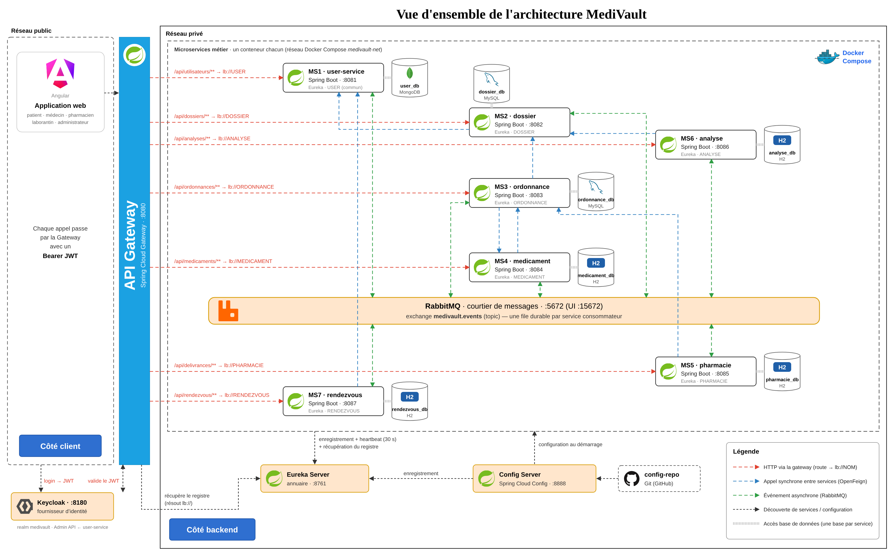

# MediVault

**Votre santé, en sécurité, dans un seul dossier.**

Projet réalisé dans le cadre du module **Applications Web Distribuées** à ESPRIT — année universitaire 2026-2027.

| | |
|---|---|
| **Équipe** | Keystone |
| **Classe** | 4DAS_I4 |
| **Encadrant** | M. Abdessalem Ghodbeni |
| **Gestion de projet** | [Tableau Trello](https://trello.com/b/F1iDFLDE/medivault) |

---

## Sommaire

1. [Présentation](#présentation)
2. [Fonctionnalités](#fonctionnalités)
3. [Architecture](#architecture)
4. [Communication entre microservices](#communication-entre-microservices)
5. [Contrats d'API](#contrats-dapi)
6. [Technologies](#technologies)
7. [Structure du dépôt](#structure-du-dépôt)
8. [Lancement du projet](#lancement-du-projet)
9. [Documentation](#documentation)
10. [Équipe](#équipe)

---

## Présentation

Aujourd'hui, chaque médecin, laboratoire ou pharmacie garde ses propres informations sur le patient, souvent sur papier. Le patient transporte lui-même ses ordonnances et ses résultats d'analyses, un médecin peut prescrire un médicament auquel le patient est allergique, et une même ordonnance papier peut être utilisée plusieurs fois.

**MediVault** est une plateforme web basée sur une architecture microservices qui donne à chaque patient un **dossier médical numérique unique**, consultable par un professionnel de santé (médecin ou laboratoire) uniquement avec l'accord du patient.

Le nom vient de *medi* (médical) et *vault* (coffre-fort) : MediVault est le coffre-fort de la santé du patient. **Keystone**, la clé de voûte, est l'équipe qui le construit.

> Périmètre : médecine générale et analyses biologiques courantes (sang, urine). L'imagerie médicale, la facturation et le remboursement sont hors périmètre. Toutes les données utilisées sont fictives.

---

## Fonctionnalités

### Patient
- Création de compte et authentification
- Consultation de son dossier médical (groupe sanguin, allergies, antécédents, consultations)
- Autorisation ou retrait de l'accès d'un professionnel (médecin ou laboratoire) à son dossier
- Prise et annulation de rendez-vous chez un médecin ou au laboratoire, selon leurs disponibilités
- Consultation de ses ordonnances et des résultats de ses analyses
- Notifications en temps réel

### Médecin
- Profil professionnel (adresse du cabinet, ville, jours et heures de travail)
- Consultation du dossier d'un patient après autorisation et ajout de consultations
- Rédaction d'ordonnances avec vérification automatique :
  - des allergies du patient (par classe thérapeutique)
  - des interactions entre médicaments
- Demande d'analyses biologiques

### Laboratoire (laborantin)
- Profil professionnel et disponibilités
- Analyses à traiter : une analyse est affectée au laboratoire quand le patient y prend rendez-vous
- Saisie des résultats, uniquement par le laboratoire affecté et avec un accès ACTIF au dossier

### Pharmacien
- Recherche d'une ordonnance par son code et délivrance (totale ou partielle)
- Chaque ligne d'une ordonnance n'est délivrée qu'une seule fois
- Délivrance bloquée pour un médicament retiré du catalogue

### Administrateur
- Gestion des comptes et des rôles
- Gestion du catalogue des médicaments, des interactions et retrait d'un médicament

---

## Architecture



L'application est composée de **sept microservices métier** et de composants d'infrastructure. Chaque microservice possède sa propre base de données et est développé par un membre de l'équipe ; le microservice `user-service` est commun à toute l'équipe.

| Microservice | Responsabilité | Données gérées | Base de données | Responsable |
|---|---|---|---|---|
| `user-service` (commun) | Comptes et rôles (Keycloak), profils des professionnels, notifications temps réel (SSE) | Utilisateur, Professionnel, Notification | MongoDB | Toute l'équipe |
| `dossier-service` | Dossier médical, consultations, accès au dossier (médecin ou laboratoire) | Dossier, Consultation, AccesDossier | MySQL | Eya |
| `ordonnance-service` | Rédaction et cycle de vie des ordonnances, contrôle avant validation | Ordonnance, LigneOrdonnance | MySQL | Amine |
| `medicament-service` | Catalogue, interactions, vérification de compatibilité, retrait, statistiques | Medicament, Interaction | H2 | Fedia |
| `pharmacie-service` | Délivrance unique (totale ou partielle), blocage des médicaments retirés | Pharmacie, Delivrance, MedicamentBloque | H2 | Aziz |
| `analyse-service` | Analyses demandées, affectation au laboratoire du rendez-vous, résultats | Analyse, ResultatAnalyse | H2 | Taha |
| `rendezvous-service` | Créneaux selon les horaires du professionnel, rendez-vous | Creneau, RendezVous | H2 | Yazid |

### Infrastructure

| Composant | Rôle |
|---|---|
| API Gateway | Point d'entrée unique, routage et vérification du jeton JWT |
| Eureka Server | Découverte des services |
| Config Server | Configuration centralisée |
| Keycloak | Authentification et rôles (OAuth2 / JWT) : PATIENT, MEDECIN, PHARMACIEN, LABORANTIN, ADMIN |
| RabbitMQ | Courtier de messages : exchange `medivault.events` (topic), une file durable par service consommateur |

---

## Communication entre microservices

Chaque microservice dispose d'au moins une communication **synchrone** et d'une communication **asynchrone** (publication et consommation d'un événement).

- **Synchrone :** OpenFeign, avec disjoncteur et méthode de repli (Resilience4j)
- **Asynchrone :** RabbitMQ (Spring AMQP). Chaque service publie ses événements sur l'exchange `medivault.events` (type topic) avec une clé de routage (ex. `ordonnance.delivree`). Chaque service consommateur possède sa propre file durable, liée aux clés qui l'intéressent.

| Microservice | Appel synchrone (OpenFeign) | Publie | Consomme |
|---|---|---|---|
| `user-service` | Keycloak (Admin API) : création du compte et attribution du rôle | `UtilisateurCree` | `AccesAccorde`, `OrdonnanceCreee`, `ResultatDisponible`, `RendezVousConfirme` (notifications) |
| `dossier-service` | `user-service` : le professionnel existe-t-il et est-il actif ? | `ConsultationAjoutee`, `AccesAccorde` | `UtilisateurCree` (dossier vide), `ResultatDisponible`, `OrdonnanceDelivree` (historique) |
| `ordonnance-service` | `dossier-service` : allergies du patient ; `medicament-service` : compatibilité | `OrdonnanceCreee` | `OrdonnanceDelivree` (statut DELIVREE) |
| `medicament-service` | `ordonnance-service` : ordonnances actives contenant le médicament | `MedicamentRetire` | `OrdonnanceDelivree` (statistiques de consommation) |
| `pharmacie-service` | `ordonnance-service` : ordonnance valide et non délivrée ? | `OrdonnanceDelivree` | `MedicamentRetire` (blocage de la délivrance) |
| `analyse-service` | `dossier-service` : le laboratoire a-t-il un accès ACTIF au dossier ? | `ResultatDisponible` | `ConsultationAjoutee` (analyse EN_ATTENTE), `RendezVousConfirme` (analyse EN_COURS) |
| `rendezvous-service` | `user-service` : jours et heures de travail du médecin ou du laboratoire | `RendezVousConfirme` | `ConsultationAjoutee` (rendez-vous terminé) |

### Événements métier

| Événement | Clé de routage | Producteur | Consommateurs | Contenu |
|---|---|---|---|---|
| `UtilisateurCree` | `utilisateur.cree` | user | dossier | utilisateurId, role, nom |
| `AccesAccorde` | `acces.accorde` | dossier | user | dossierId, patientId, professionnelId |
| `ConsultationAjoutee` | `consultation.ajoutee` | dossier | rendezvous, analyse | consultationId, patientId, medecinId, analysesDemandees |
| `OrdonnanceCreee` | `ordonnance.creee` | ordonnance | user | ordonnanceId, code, patientId |
| `OrdonnanceDelivree` | `ordonnance.delivree` | pharmacie | ordonnance, dossier, medicament | ordonnanceId, patientId, lignesDelivrees, type |
| `MedicamentRetire` | `medicament.retire` | medicament | pharmacie | medicamentId, motif, date |
| `ResultatDisponible` | `resultat.disponible` | analyse | dossier, user | analyseId, patientId, laboratoireId, typeAnalyse |
| `RendezVousConfirme` | `rendezvous.confirme` | rendezvous | user, analyse | rendezVousId, patientId, professionnelId, typeProfessionnel, date |

**Données locales alimentées par les événements :**
- `pharmacie-service` enregistre chaque médicament retiré dans `MedicamentBloque` (événement `MedicamentRetire`) : la délivrance est bloquée sans rappeler `medicament-service`.
- `medicament-service` incrémente `nb_delivrances` du médicament à chaque `OrdonnanceDelivree` (statistiques de consommation).
- `analyse-service` renseigne `laboratoire_id` à la réception de `RendezVousConfirme` (rendez-vous au laboratoire) : seul ce laboratoire peut saisir le résultat, après vérification de son accès au dossier.

### En cas de panne

Appels synchrones : un disjoncteur et une méthode de repli (Resilience4j) prennent le relais.

| Appel synchrone | Si le service appelé est indisponible |
|---|---|
| dossier → user | Accès refusé (503) : aucune donnée médicale sans vérification |
| ordonnance → dossier / medicament | Ordonnance enregistrée « EN_ATTENTE_VERIFICATION », non délivrable |
| medicament → ordonnance | Retrait publié quand même ; liste des ordonnances recalculée plus tard |
| pharmacie → ordonnance | Délivrance refusée (503), nouvel essai proposé |
| analyse → dossier | Saisie du résultat refusée (503) |
| rendezvous → user | Créneaux non générés, message « réessayer plus tard » |

- **Événement :** les messages sont persistants et restent dans la file du service consommateur ; un service arrêté les traite à son redémarrage (acquittement après traitement).

Les références entre microservices se font uniquement par identifiant (par exemple `patient_id`, `ordonnance_id`), sans relation directe entre les bases de données.

---

## Contrats d'API

Tous les endpoints sont exposés via l'API Gateway, protégés par JWT (Keycloak) et documentés avec Swagger / OpenAPI. Un POST réussi renvoie 201 avec l'en-tête `Location` ; les erreurs suivent le format Problem Details (RFC 9457) ; 409 signale une règle métier violée.

| Service | Méthode | Endpoint | Description | Codes HTTP |
|---|---|---|---|---|
| user | POST | `/api/utilisateurs` | Créer un compte | 201, 400, 409 |
| user | GET | `/api/utilisateurs/{id}` | Consulter un utilisateur | 200, 404 |
| user | GET | `/api/professionnels?type=&ville=` | Rechercher un médecin / laboratoire | 200 |
| user | GET | `/api/professionnels/{id}/disponibilites` | Jours et heures de travail | 200, 404 |
| user | GET | `/api/utilisateurs/{id}/notifications` | Notifications | 200 |
| user | GET | `/api/notifications/stream` | Flux temps réel (SSE) | 200 |
| user | PATCH | `/api/notifications/{id}` | Marquer comme lue | 200, 404 |
| dossier | GET | `/api/dossiers/patient/{patientId}` | Consulter un dossier | 200, 403, 404, 503 |
| dossier | POST | `/api/dossiers/{id}/consultations` | Ajouter une consultation | 201, 400, 403 |
| dossier | GET | `/api/dossiers/patient/{patientId}/allergies` | Allergies du patient | 200, 404 |
| dossier | GET | `/api/dossiers/patient/{patientId}/acces?professionnelId=` | Accès ACTIF du professionnel ? | 200, 404 |
| dossier | POST | `/api/dossiers/{id}/acces` | Accorder un accès | 201, 400, 404, 409 |
| dossier | PATCH | `/api/dossiers/{id}/acces/{professionnelId}` | Retirer un accès | 200, 404 |
| ordonnance | POST | `/api/ordonnances` | Rédiger (avec vérification) | 201, 400, 409 |
| ordonnance | GET | `/api/ordonnances/{code}` | Consulter par code | 200, 404 |
| ordonnance | GET | `/api/ordonnances?patientId=` | Ordonnances d'un patient | 200 |
| ordonnance | GET | `/api/ordonnances?medicamentId=&statut=` | Recherche par médicament | 200 |
| medicament | GET | `/api/medicaments` | Catalogue | 200 |
| medicament | POST | `/api/medicaments` | Ajouter un médicament | 201, 400 |
| medicament | POST | `/api/medicaments/compatibilite` | Compatibilité allergies / interactions | 200, 400 |
| medicament | DELETE | `/api/medicaments/{id}` | Retirer du catalogue | 204, 404 |
| pharmacie | GET | `/api/pharmacies` | Lister les pharmacies | 200 |
| pharmacie | POST | `/api/delivrances` | Délivrer une ordonnance | 201, 404, 409, 503 |
| pharmacie | GET | `/api/delivrances?pharmacieId=` | Historique | 200 |
| pharmacie | GET | `/api/delivrances/ordonnance/{id}` | Délivrance d'une ordonnance | 200, 404 |
| analyse | GET | `/api/analyses?statut=EN_COURS&laboratoireId=` | Analyses à traiter | 200 |
| analyse | POST | `/api/analyses/{id}/resultats` | Saisir un résultat | 201, 400, 403, 503 |
| analyse | GET | `/api/analyses/patient/{patientId}` | Analyses d'un patient | 200 |
| analyse | GET | `/api/analyses/{id}` | Détail | 200, 404 |
| rendezvous | POST | `/api/creneaux` | Générer les créneaux d'un professionnel | 201, 400, 404, 503 |
| rendezvous | GET | `/api/creneaux?professionnelId=&date=` | Créneaux libres | 200 |
| rendezvous | POST | `/api/rendezvous` | Prendre un rendez-vous | 201, 409 |
| rendezvous | PATCH | `/api/rendezvous/{id}` | Annuler (statut ANNULE) | 200, 404, 409 |

---

## Technologies

| Domaine | Technologies |
|---|---|
| Back-end | Java 17, Spring Boot 3.5, Spring Data JPA, Spring Data MongoDB |
| Spring Cloud | Gateway, Eureka, Config Server, OpenFeign |
| Messagerie | RabbitMQ (Spring AMQP) |
| Résilience | Resilience4j |
| Temps réel | Server-Sent Events (SSE) |
| Sécurité | Keycloak (OAuth2 / JWT) |
| Front-end | Angular |
| Bases de données | MySQL, H2, MongoDB |
| Déploiement | Docker, Docker Compose |
| Documentation des API | Swagger / OpenAPI |
| Gestion de projet | GitHub, Trello |

---

## Structure du dépôt

```
medivault-4dasi4-keystone/
├── Backend/
│   ├── eureka-server/ · config-server/ · api-gateway/
│   ├── user-service/ · dossier-service/ · ordonnance-service/
│   ├── medicament-service/ · pharmacie-service/
│   └── analyse-service/ · rendezvous-service/
├── Frontend/                # application Angular
├── Documentation/
│   ├── Presentation/        # support de présentation
│   ├── Diagrams/            # cas d'utilisation, classes, architecture, communication
│   └── MediVault_Dossier_Technique.docx
├── .gitignore
└── README.md
```

---

## Lancement du projet

### Prérequis

- **Docker Desktop** (suffit pour tout lancer : aucun Java, Maven ni Node n'est nécessaire)
- Pour développer un service : Java 17, Maven, Node.js 22 et Angular CLI

> **Port 9000** : c'est le port de la Gateway, toujours. S'il est déjà pris par un autre programme
> (par exemple un conteneur ClickHouse), l'arrêter d'abord : `docker ps` puis `docker stop <nom>`.

### 1. Tout lancer avec Docker (recommandé)

```bash
git clone https://github.com/fedia-ltf/medivault-4dasi4-keystone.git
cd medivault-4dasi4-keystone
docker compose --profile app up -d --build
```

Le premier lancement construit les images (quelques minutes). Ensuite, en 1 à 2 minutes, tout est prêt :

| Quoi | Adresse |
|---|---|
| **Application (front Angular)** | http://localhost:4200 |
| **API Gateway** (seule porte d'entrée de l'API) | http://localhost:9000/api/... |
| **Swagger unifié** (les 7 services) | http://localhost:9000/swagger-ui.html |
| Eureka (services inscrits) | http://localhost:8761 |
| RabbitMQ (files et messages) | http://localhost:15672 (`guest` / `guest`) |
| Keycloak (comptes et rôles) | http://localhost:8180 (`admin` / `admin`, realm `medivault`) |
| Mailpit (e-mails « mot de passe oublié ») | http://localhost:8025 |

Commandes utiles :

```bash
docker compose --profile app ps                 # état de chaque conteneur
docker compose --profile app logs -f gateway    # journaux d'un service
docker compose --profile app down               # tout arrêter (les données restent)
docker compose --profile app down -v            # tout arrêter ET effacer les données
```

**Comptes de démonstration** (mot de passe de tous : `Medivault2026!`, développement seulement) :
`admin@medivault.tn` (ADMIN), `karim.trabelsi@medivault.tn` (MEDECIN), `ahmed.benali@medivault.tn` (PATIENT),
`contact@biolab.tn` (LABORANTIN), `pharmacie.centrale@medivault.tn` (PHARMACIEN).

### 2. Lancer les services un par un (développement)

```bash
docker compose up -d        # seulement l'infrastructure : MySQL, MongoDB, RabbitMQ, Keycloak, Mailpit
```

Puis, dans cet ordre (IntelliJ ou `mvn spring-boot:run` dans chaque dossier de `Backend/`) :
`eureka-server` → `user-service` (profil `keycloak`) → `dossier-service` → `ordonnance-service` → `medicament-service`
→ `soin-domicile-service` → `analyse-service` → `rendezvous-service` → `api-gateway`, et enfin le front :

```bash
cd Frontend/medivault-frontend
npm install
npm start                   # http://localhost:4200 (proxy /api → Gateway 9000)
```

### Sécurité

- Le front, Postman et Swagger passent **uniquement par la Gateway (9000)**.
- La Gateway exige un **jeton JWT Keycloak** (`Authorization: Bearer ...`) pour tout `/api/**`, sauf `/api/auth/**`
  (connexion, inscription, mot de passe oublié). Jeton : `POST http://localhost:9000/api/auth/login`
  avec `{"email": "...", "motDePasse": "..."}` → `accessToken`.
- Les microservices s'appellent entre eux directement : OpenFeign (trouvés par Eureka) et RabbitMQ.
- Dans Swagger : bouton **Authorize**, coller le jeton, puis « Try it out » (les requêtes passent par la Gateway).

### Voir les données de chaque base

| Service | Base | Comment la voir |
|---|---|---|
| user-service | MongoDB `user_db` | http://localhost:8090 (mongo-express) ou MongoDB Compass sur `mongodb://localhost:27017` |
| dossier-service | MySQL `dossier_db` | MySQL Workbench sur `localhost:3306`, utilisateur `root`, sans mot de passe |
| ordonnance-service | MySQL `ordonnance_db` | idem, ou `docker compose exec mysql mysql -uroot` |
| medicament-service | H2 fichier | http://localhost:8084/h2-console |
| soin-domicile-service | H2 fichier | http://localhost:8085/h2-console |
| analyse-service | H2 fichier | http://localhost:8086/h2-console |
| rendezvous-service | H2 fichier | http://localhost:8087/h2-console |
| Keycloak | comptes et rôles | http://localhost:8180 → realm `medivault` → Users |
| RabbitMQ | messages | http://localhost:15672 → Queues |

Consoles H2 : utilisateur `sa`, mot de passe vide, et l'URL JDBC suivante :

| Service | Avec Docker | Lancé un par un |
|---|---|---|
| medicament | `jdbc:h2:file:/app/data/medicament_db` | `jdbc:h2:file:./data/medicament_db` |
| soin-domicile | `jdbc:h2:file:./soin-domicile-data/soin_domicile_db` | idem |
| analyse | `jdbc:h2:file:./analyse-data/analyse_db` | idem |
| rendezvous | `jdbc:h2:file:./rendezvous-data/rendezvous_db` | idem |

### Postman

Les collections sont dans `Backend/<service>/postman/`. Elles passent par la Gateway (`{{gateway}}` = http://localhost:9000)
et commencent par la connexion Keycloak, qui garde le jeton pour les requêtes suivantes : **Run collection**.

---

## Documentation

- [Dossier technique (Word)](Documentation/MediVault_Dossier_Technique.docx)
- [Présentation — Validation 1](Documentation/Presentation/)
- [Architecture détaillée](Documentation/Diagrams/architecture-detaillee.png)
- [Diagramme de cas d'utilisation](Documentation/Diagrams/cas-utilisation.png)
- [Diagramme de classes](Documentation/Diagrams/diagramme-classes.png)
- [Diagramme de communication](Documentation/Diagrams/diagramme-communication.png)
- Suivi des tâches du `medicament-service` : [tableau Trello](https://trello.com/invite/b/6af09c9d4ad53053d4a7099f/ATTIffcc29e2492b3902ac012ac4fe605578E75BCE33/medivault-medicament-service-fedia) ([capture](Documentation/Diagrams/trello-medicament-service.jpg))

---

## Équipe

**Équipe Keystone — 4DAS_I4**

| Membre | Gestion | Microservice | Partie commune |
|---|---|---|---|
| Eya | Dossier médical | `dossier-service` | Keycloak (realm, rôles) et intégration Admin API |
| Amine | Ordonnances | `ordonnance-service` | RabbitMQ (exchange, clés de routage, format des événements) |
| Fedia | Médicaments | `medicament-service` | Dépôt Git, README et diagrammes |
| Aziz | Pharmacie | `pharmacie-service` | API Gateway, Eureka, Config Server, modèle MongoDB du user-service |
| Taha | Analyses | `analyse-service` | Socle Angular, Docker Compose, notifications temps réel |
| Yazid | Rendez-vous | `rendezvous-service` | Présentation et suivi des tâches |

Chaque membre réalise la partie back-end et front-end de sa gestion et effectue des commits réguliers dans son propre microservice. Le suivi des tâches se fait sur le [tableau Trello](https://trello.com/b/F1iDFLDE/medivault) (une carte par tâche, un responsable, une échéance).
