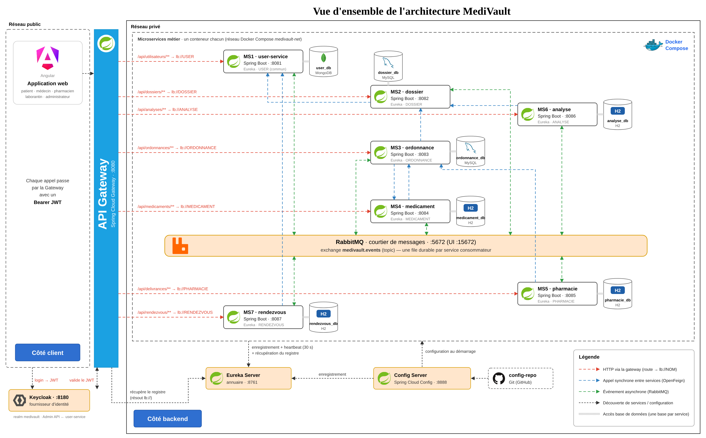

# MediVault

**Votre santé, en sécurité, dans un seul dossier.**

Projet réalisé dans le cadre du module **Applications Web Distribuées** à ESPRIT — année universitaire 2026-2027.

| | |
|---|---|
| **Équipe** | Keystone |
| **Classe** | 4DAS_I4 |
| **Encadrant** | M. Abdessalem Ghodbani |

---

## Sommaire

1. [Présentation](#présentation)
2. [Fonctionnalités](#fonctionnalités)
3. [Architecture](#architecture)
4. [Communication entre microservices](#communication-entre-microservices)
5. [Technologies](#technologies)
6. [Structure du dépôt](#structure-du-dépôt)
7. [Lancement du projet](#lancement-du-projet)
8. [Documentation](#documentation)
9. [Équipe](#équipe)

---

## Présentation

Aujourd'hui, chaque médecin, laboratoire ou pharmacie garde ses propres informations sur le patient, souvent sur papier. Le patient transporte lui-même ses ordonnances et ses résultats d'analyses, un médecin peut prescrire un médicament auquel le patient est allergique, et une même ordonnance papier peut être utilisée plusieurs fois.

**MediVault** est une plateforme web basée sur une architecture microservices qui donne à chaque patient un **dossier médical numérique unique**, consultable par un professionnel de santé uniquement avec l'accord du patient.

Le nom vient de *medi* (médical) et *vault* (coffre-fort) : MediVault est le coffre-fort de la santé du patient. **Keystone**, la clé de voûte, est l'équipe qui le construit.

> Périmètre : médecine générale et analyses biologiques courantes. Toutes les données utilisées sont fictives.

---

## Fonctionnalités

### Patient
- Création de compte et authentification
- Consultation de son dossier médical (groupe sanguin, allergies, antécédents, consultations)
- Autorisation ou retrait de l'accès d'un médecin à son dossier
- Prise de rendez-vous chez un médecin ou au laboratoire, selon leurs disponibilités
- Consultation de ses ordonnances et des résultats de ses analyses
- Notifications en temps réel

### Médecin
- Profil professionnel (adresse du cabinet, jours et heures de travail)
- Consultation du dossier d'un patient après autorisation
- Rédaction d'ordonnances avec vérification automatique :
  - des allergies du patient (par classe thérapeutique)
  - des interactions entre médicaments
- Demande d'analyses biologiques

### Laboratoire
- Profil professionnel et disponibilités
- Réception des demandes d'analyses et saisie des résultats

### Pharmacien
- Recherche d'une ordonnance et délivrance (totale ou partielle)
- Une ordonnance ne peut être délivrée qu'une seule fois

### Administrateur
- Gestion des comptes et des rôles
- Gestion du catalogue des médicaments et retrait d'un médicament

---

## Architecture



L'application est composée de **sept microservices métier** et de composants d'infrastructure. Chaque microservice possède sa propre base de données et est développé par un membre de l'équipe ; le microservice `user-service` est commun à toute l'équipe.

| Microservice | Responsabilité | Base de données | Responsable |
|---|---|---|---|
| `user-service` (commun) | Comptes et rôles (Keycloak), profils des professionnels, notifications temps réel | MongoDB | Toute l'équipe |
| `dossier-service` | Dossier médical, consultations, accès au dossier | MySQL | Eya |
| `ordonnance-service` | Ordonnances et vérifications avant validation | MySQL | Amine |
| `medicament-service` | Catalogue des médicaments et interactions | H2 | Fedia |
| `pharmacie-service` | Délivrance des ordonnances | H2 | Aziz |
| `analyse-service` | Demandes d'analyses et résultats | H2 | Taha |
| `rendezvous-service` | Créneaux et rendez-vous | H2 | Yazid |

### Infrastructure

| Composant | Rôle |
|---|---|
| API Gateway | Point d'entrée unique, routage et vérification du jeton JWT |
| Eureka Server | Découverte des services |
| Config Server | Configuration centralisée |
| Keycloak | Authentification et gestion des rôles (OAuth2 / JWT) |
| Apache Kafka | Broker d'événements entre microservices (un topic par événement) |

---

## Communication entre microservices

Chaque microservice dispose d'au moins une communication **synchrone** et d'une communication **asynchrone** (publication et consommation d'un événement).

- **Synchrone :** OpenFeign, avec disjoncteur et méthode de repli (Resilience4j)
- **Asynchrone :** Apache Kafka, un topic par événement (ex. `medivault.ordonnance-delivree`), chaque service consommateur avec son propre `groupId`

| Microservice | Appel synchrone (OpenFeign) | Publie | Consomme |
|---|---|---|---|
| `user-service` | Keycloak (Admin API) : création du compte et attribution du rôle | `UtilisateurCree` | `AccesAccorde`, `OrdonnanceCreee`, `ResultatDisponible`, `RendezVousConfirme` (notifications) |
| `dossier-service` | `user-service` : vérifier que le médecin existe et est actif | `ConsultationAjoutee`, `AccesAccorde` | `UtilisateurCree`, `ResultatDisponible`, `OrdonnanceDelivree` |
| `ordonnance-service` | `dossier-service` : allergies du patient ; `medicament-service` : compatibilité | `OrdonnanceCreee` | `OrdonnanceDelivree` |
| `medicament-service` | `ordonnance-service` : ordonnances actives contenant le médicament | `MedicamentRetire` | `OrdonnanceDelivree` |
| `pharmacie-service` | `ordonnance-service` : ordonnance valide et non délivrée | `OrdonnanceDelivree` | `MedicamentRetire` |
| `analyse-service` | `dossier-service` : laboratoire autorisé | `ResultatDisponible` | `ConsultationAjoutee`, `RendezVousConfirme` |
| `rendezvous-service` | `user-service` : jours et heures de travail du professionnel | `RendezVousConfirme` | `ConsultationAjoutee` |

En cas d'indisponibilité d'un service appelé, un disjoncteur et une méthode de repli prennent le relais. Les événements restent stockés dans Kafka : un service redémarré reprend la lecture à son dernier offset, et l'historique des événements médicaux est conservé (traçabilité).

Les références entre microservices se font uniquement par identifiant (par exemple `patient_id`, `ordonnance_id`), sans relation directe entre les bases de données.

---

## Technologies

| Domaine | Technologies |
|---|---|
| Back-end | Java 17, Spring Boot 3, Spring Data JPA, Spring Data MongoDB |
| Spring Cloud | Gateway, Eureka, Config Server, OpenFeign |
| Messagerie | Apache Kafka |
| Résilience | Resilience4j |
| Sécurité | Keycloak (OAuth2 / JWT) |
| Front-end | Angular |
| Bases de données | MySQL, H2, MongoDB |
| Déploiement | Docker, Docker Compose |
| Documentation des API | Swagger / OpenAPI |

---

## Structure du dépôt

```
medivault-4dasi4-keystone/
├── Backend/                 # microservices Spring Boot et infrastructure
├── Frontend/                # application Angular
├── Documentation/
│   ├── Presentation/        # support de présentation
│   └── Diagrams/            # diagrammes (cas d'utilisation, classes, architecture, communication)
├── .gitignore
└── README.md
```

---

## Lancement du projet

> Le développement démarre après la validation de la conception. Cette section sera complétée au fur et à mesure de l'avancement.

### Prérequis

- Java 17
- Maven
- Node.js et Angular CLI
- Docker et Docker Compose

### Démarrage (à venir)

```bash
git clone https://github.com/fedia-ltf/medivault-4dasi4-keystone.git
cd medivault-4dasi4-keystone
docker-compose up -d
```

---

## Documentation

- [Architecture détaillée](Documentation/Diagrams/architecture-detaillee.png)
- [Architecture globale](Documentation/Diagrams/architecture.png)
- [Diagramme de cas d'utilisation](Documentation/Diagrams/cas-utilisation.png)
- [Diagramme de classes](Documentation/Diagrams/diagramme-classes.png)
- [Diagramme de communication](Documentation/Diagrams/diagramme-communication.png)

---

## Équipe

**Équipe Keystone — 4DAS_I4**

| Membre | Gestion | Microservice |
|---|---|---|
| Eya | Dossier médical | `dossier-service` |
| Amine | Ordonnances | `ordonnance-service` |
| Fedia | Médicaments | `medicament-service` |
| Aziz | Pharmacie | `pharmacie-service` |
| Taha | Analyses | `analyse-service` |
| Yazid | Rendez-vous | `rendezvous-service` |

Chaque membre réalise la partie back-end et front-end de sa gestion.
